# vEditor

**One window for GTA V / FiveM assets** — textures, models, the map and its traffic paths, timecycles,
animations, clothing, tattoos, weapons and vehicles — reading the game's own files directly, with no extracting
first.

**[⬇ Download the latest version](https://github.com/vEditor-cmyk/vEditor/releases/latest)** — Windows, free ·
[what is new](CHANGELOG.md) · [how to install](#download-and-install)

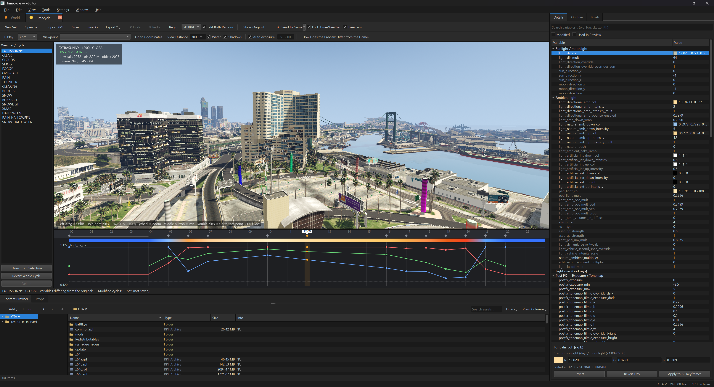

vEditor is made for convenience: the everyday jobs of a FiveM server in one program instead of a handful.
I will keep adding tools as far as I can.

- **Free.** Everything in vEditor is free to use. The one exception is AI: vEditor sells no AI of its own — it
  asks the AI service you choose, on your own subscription or API key, and that service bills you. Every AI
  feature is optional; the rest of the program works without it. If vEditor saves you time and you would like to
  support it, you can [buy me a coffee](https://buymeacoffee.com/veditor) — never needed, always appreciated.
- **Private.** vEditor does not collect anything about you and sends nothing to a server of mine: no account, no
  telemetry. It goes online only for these:
  - the **update check** — once at start, it asks GitHub for the latest release on this page and nothing else (no
    information about you or your files). A newer version is only told about, never downloaded or installed:
    you choose whether to update, and the version you have keeps working. Switch it off under
    *Help → Check for Updates at Start*;
  - an AI request, when you press a **Generate** button — sent to the model you picked there, and to no other;
  - the Timecycle Editor's **Send to Game**, which talks to your own FiveM server (normally `127.0.0.1`).

  Settings, API keys (encrypted by Windows for your account) and caches stay on your computer.

## Showcase

**Generate a shirt texture with AI** — Cloth Tool → UV page: a request ("USA Shirt") is drawn onto the garment's
UV layout, added as a new texture and worn by the character.

[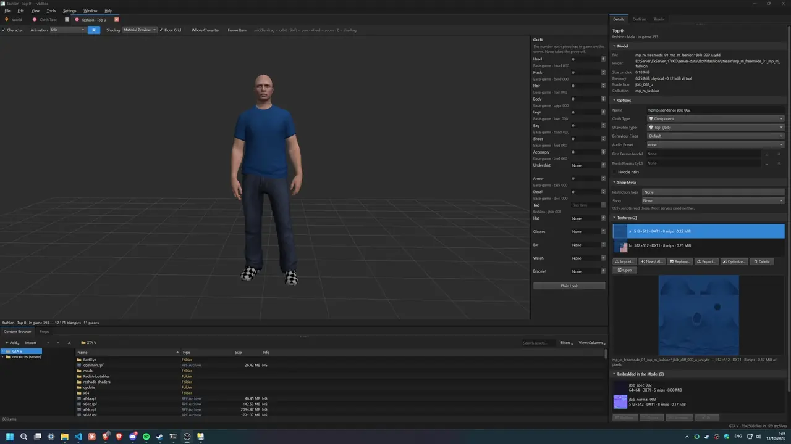](showcase/videos/genarate-shirt.mp4)

**Take a shirt from the game** — Cloth Tool → *Add Models → From the Game*: one of the game's own tops becomes an
item of your pack, with its files.

[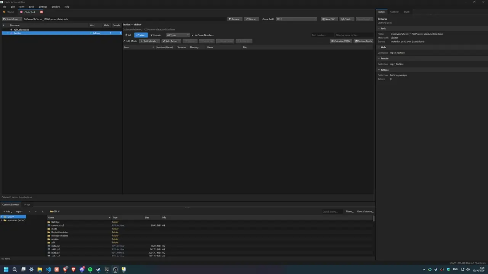](showcase/videos/import-shirt-from-game.mp4)

**Generate an animation with AI** — Animation editor → *AI Assistant*: "old man walk" comes back as keyframes on
the character's bones.

[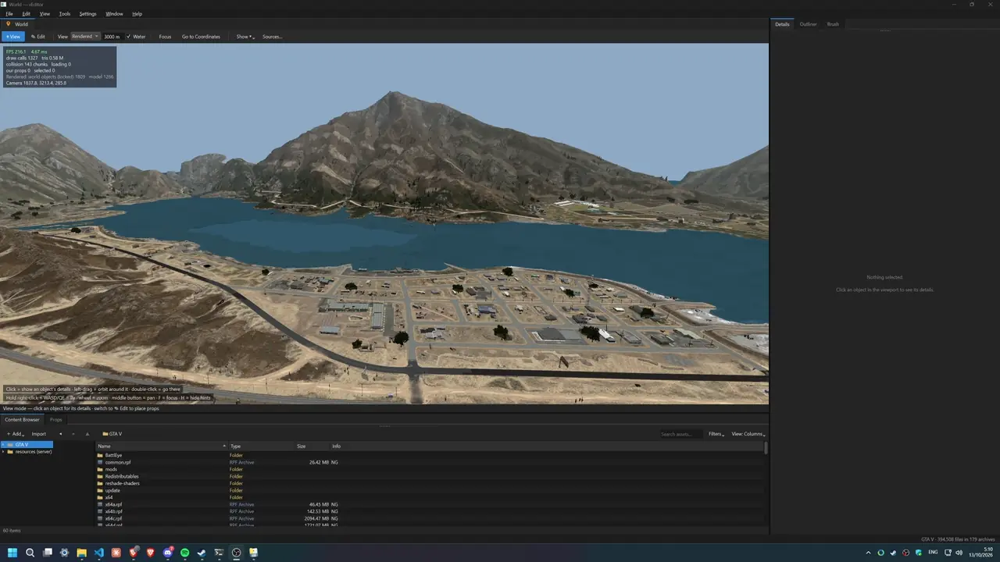](showcase/videos/genarate-animation.mp4)

**Replace an animation with a file** — *Replace…*: the motion of an `.fbx` is put onto the game's character in the
place of an animation.

The clips play on their own, at a smaller size; click one for the full video (1080p, 60 fps, H.265 `.mp4` —
if your browser does not play it, download it and open it in a video player). The two AI clips were made with
Claude through Claude Code; other AI models can give better results than these samples — see
[AI](#ai-optional).

Pictures are with the tools below: [Vehicle Tool](#vehicle-tool) (sirens, siren lights, liveries),
[World and Map Editor](#world-and-map-editor) (your server's maps, interiors), [Image Editor](#image-editor),
[a day in game](#timecycle-editor) (one street from morning to night), [Textures](#textures),
[Attach Prop](#animations).

## Tools

### Content Browser and the game's files

- **Reads the game directly.** vEditor opens GTA V's `.rpf` archives itself — every file of the game can be found
  by name (*File → Open from Game…*), opened or exported. The game's AES key does not ship with the program: it
  is found in your own `GTA5.exe` the first time, and it unlocks the rest (CodeWalker's `magic.dat`, which is of no
  use without the game). The game's files are only read.
- **Content Browser** — the GTA V folder, your server's `resources` folders and any folder you add, side by side;
  `.rpf` archives are entered like folders. Grid / List / Columns, a colour per file type, search through
  everything below a folder (archives included), filters by type. New Folder, Import, Rename, Delete and Export
  work on disk and inside archives; drop files in from Explorer. Right-click also makes a **new animation
  (`.ycd`)** or an empty **texture dictionary (`.ytd`)** in the folder on show and opens it. The folders of the
  path above the list have the same right-click menu as the folders themselves.
- **Reload Map** — right-click a resource: its files are read again from the disk and the World shows them as they
  are now (a map you changed in another tool), without loading the whole world again.
- **RPF Explorer** — open or create an `.rpf` (a mod's `dlc.rpf`, for example), import and export files and
  whole folders, nested archives, rename, delete, *Defragment*. Textures inside an archive can be edited and
  saved back in place.

### XML, as CodeWalker makes it

- **Export XML** — right-click files in the Content Browser (on disk, inside an `.rpf`, or the game's own) or in
  an RPF Explorer tab, or *File → Export XML…*: CodeWalker's XML of each file, with its textures as `.dds` (sounds
  as `.wav`) in a folder beside it — the XML Sollumz and CodeWalker read. Every type CodeWalker exports:
  `.ydr .ydd .yft .ytd .ycd .ybn .ymap .ytyp .ymt .ymf .ynd .ynv .ypt .yld .yed .ywr .yvr .awc .rel .cut .fxc
  .mrf .ypdb .yfd` and more.
- **Import XML** — `x.ydr.xml` → `x.ydr` (and so on): *Import XML Here* on selected XML files, *Import XML…* into
  the folder or archive on show, or *File → Import XML…*. Double-click an XML of CodeWalker's to look at what it
  makes, without keeping it.
- **Code (XML)** — right-click a `.ymap`, `.ytyp`, `.ymt`, `.ymf`, `.ynd` … → *Edit Code (XML)*: the file's XML in a
  tab of its own (line numbers, find, go to line) to read and change. *Save* turns it back into the file and writes
  it — the file as it came is kept in the resource's `.veditor_backup` folder the first time; XML CodeWalker cannot
  read is shown at its line and nothing is written. A file inside an archive is written back into the archive.
- The work is done by **CodeWalker's own library, from the CodeWalker installed on your computer** (found by
  itself, or *Settings → CodeWalker Folder…*), so the XML is exactly CodeWalker's. vEditor does not come with
  CodeWalker: its source is released for educational purposes only, without a licence to pass it on. Shader and
  model names are learnt from the game's files the way CodeWalker learns them, so they come out as names, not as
  `hash_…`.

### Textures

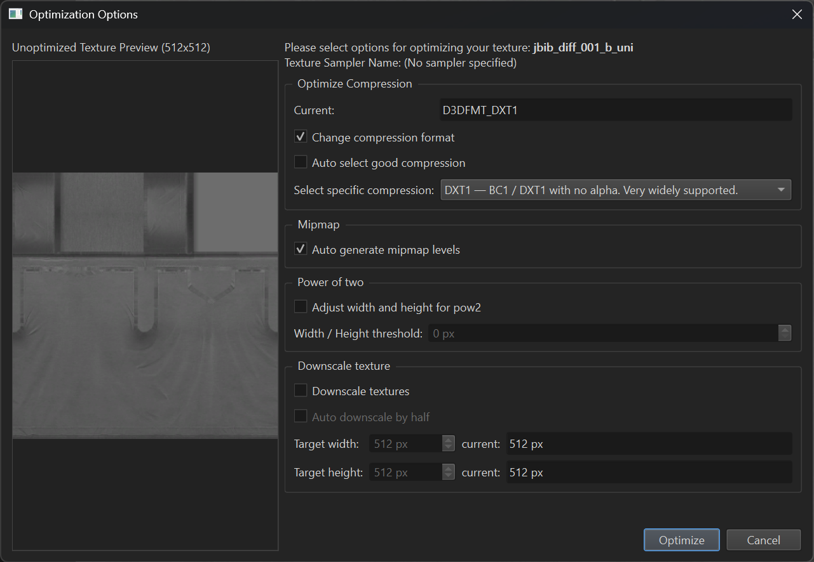

- **Texture dictionaries (`.ytd`) and the textures embedded in models (`.ydr` / `.yft`)** — a sortable list with
  size, format, mip levels and data size; a preview with a mip slider; Import, Replace, Export (PNG or DDS),
  Delete. Imports take PNG / JPG / WebP / BMP / TGA / GIF / TIFF and DDS.
- **Optimize** — change the compression (DXT1 / DXT3 / DXT5, or let vEditor choose), generate mip levels, round
  to a power of two, downscale — one texture or many at once. Alpha is kept correctly (premultiplied resizing, no
  accidental DXT1 for a texture with transparency). BC4 / BC5 / BC7 textures are read and shown, but vEditor has
  no encoder for them yet.
- **Smaller files, not only smaller textures** — saving a `.ydr` / `.yft` rebuilds its graphics segment to fit the
  textures it holds now, so the file and the memory figure the server reports really go down.
- **Texture Batch (Folder)** — every texture of every `.ytd` / `.ydr` / `.yft` below a folder in one list; filter
  by name, size or format, then convert all or a selection, over the originals (with `.bak`) or into a new folder.
- **AI…** on any texture — see [AI](#ai-optional).
- **Edit…** on any texture opens it in the [Image Editor](#image-editor); saving there puts it back into the
  texture, in the format it has.

### Image Editor

A picture editor laid out and driven like Photoshop, in a window of its own (*Tools → Image Editor*, a texture's
**Edit…**, the UV page's **Edit in Image Editor**, or a double-click on a picture file in the Content Browser).

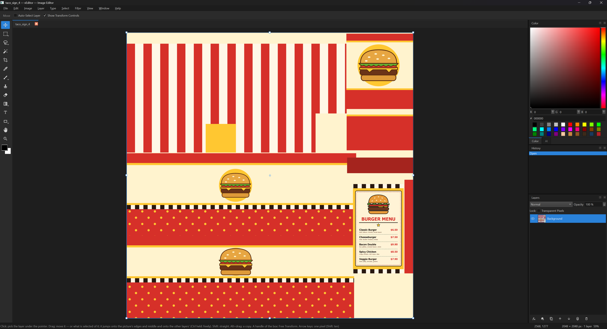

- **The layout** — the menus *File, Edit, Image, Layer, Type, Select, Filter, View, Window*; the options of the
  tool in hand under them; the toolbox down the left; the pictures in tabs; *Color*, *AI*, *History* and *Layers*
  down the right.
- **The tools and their keys** — Move `V`, Rectangular / Elliptical Marquee `M`, Lasso / Polygonal Lasso `L`,
  Magic Wand `W`, Crop `C`, Eyedropper `I`, Brush / Pencil `B`, Clone Stamp `S`, Eraser `E`, Gradient / Paint
  Bucket `G`, Type `T`, Rectangle / Ellipse / Line `U`, Hand `H`, Zoom `Z`; `X` / `D` for the colours, `[` `]` for
  the brush, *Shift* / *Alt* to add to and take from a selection, *Free Transform* `Ctrl+T` (move, resize, turn).
- **Moving things** — the Move tool picks the layer under the pointer and draws a box around what it holds (a
  handle of the box starts Free Transform); what is dragged jumps onto the picture's edges and middle and onto
  the other layers', with a line showing where (*View → Snap*; hold *Ctrl* to move freely).
- **Layers** — blend modes (23, Photoshop's names), opacity, lock transparent pixels, show / hide, drag to
  reorder, rename; *Duplicate*, *Layer via Copy / Cut* `Ctrl+J`, *Merge Down* `Ctrl+E`, *Merge Visible*, *Flatten*;
  type layers that stay editable; **Layer Style** — stroke, inner shadow, inner glow, color overlay, gradient
  overlay, outer glow, drop shadow — with *Copy / Paste Layer Style*.
- **Adjustments and filters** — Brightness/Contrast, Levels, Exposure, Hue/Saturation, Color Balance, Black &
  White, Invert, Posterize, Threshold, Desaturate, Auto Tone; Gaussian / Box / Motion Blur, Unsharp Mask, Add
  Noise, Median, Mosaic, Emboss, Find Edges, High Pass, Offset, Minimum, Maximum — previewed on the picture, and
  working through the selection.
- **AI on a part of the picture** — select the part: a bar comes up over the selection. Type what should be
  there and press Enter (nothing typed: the part is filled in to match what is around it); the answer comes back
  as a new layer cut to the selection, over what was there. The *AI* panel has the same with its settings — the
  model, the size, how soft the edge — and works on the whole picture when nothing is selected. See
  [AI](#ai-optional).
- **For textures** — *Offset* and *View → Pattern Preview* show how a tiling texture meets its own edges; opened
  from a UV page, the picture has the UV layout over it as a guide layer that is left out of what is saved back.
- **Files** — its own `.vimg` keeps the layers; PNG / JPG / WebP / TGA / BMP / TIFF / GIF and DDS open and export;
  a `.psd` opens as far as its layers are plain pixels (no blend modes or effects), and is not written.
- **Not in it** (yet): layer masks, adjustment layers, groups, smart objects, and more than 8 bits a channel.

### Models

- **Model viewer** for `.ydr` / `.yft` / `.ydd`, with their textures. The view moves as in Blender (middle-drag,
  numpad views, `Z` for the shading pie): *Wireframe*, *Solid*, *Material Preview*, *Rendered*. Embedded textures
  are on a second page of the same tab.
- **Bones** — a model with a skeleton of its own lists its bones in the Details panel, as their tree, with how many
  vertices each carries; untick one and the part of the model on it is hidden (with what hangs from it — a door
  takes its window and handle along), *Show Only* / *Show All* / *Invert*, a filter. A vehicle shows its wheels.
- **Vehicles** — a vehicle's textures are found the way the game finds them: its own `.ytd` (and `+hi.ytd`), then
  the dictionaries `vehicles.meta` gives it, down to the game's shared `vehshare`. The paint is drawn in a colour
  you pick, with the **livery** over it; the liveries of the dictionary (`…_sign_1`, `_sign_2` …) are a select.
- **UV Page…** of any texture of a model — a vehicle's livery, a prop's skin: the texture laid flat under its UV
  layout, the model beside it wearing what is on the page. Paint on it in the [Image Editor](#image-editor) with
  the layout as a guide (*Edit in Image Editor*), export the layout to paint over it elsewhere, import a
  picture, or have an AI model make one (see [AI](#ai-optional)). *Replace* writes it into the `.ytd` the texture
  is in (a copy of the file as it was is kept, outside the stream folder); *Add as New Livery* adds the next one.
- **Collision viewer** — double-click a `.ybn`: its collision in 3D, coloured by material (as CodeWalker colours
  them) or by part; the Details panel lists what it is made of — its bounds with their flags, its polygons, its
  materials — with a box to hide each material or part. *Show in World* takes the World's camera there (to where
  the interior is placed, for an interior's collision).

### World and Map Editor

| 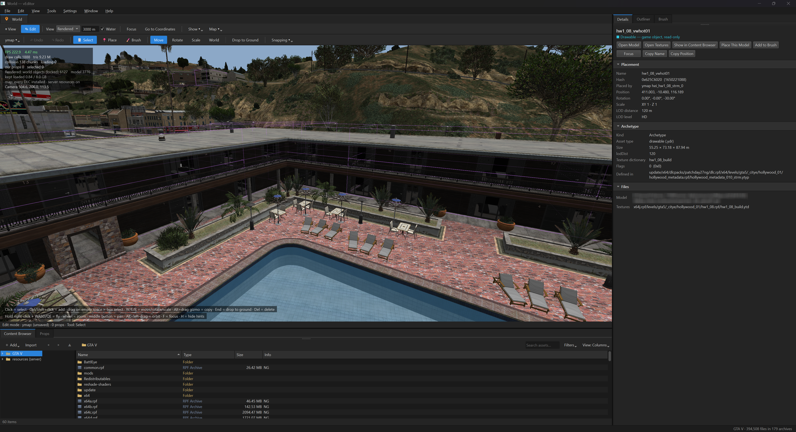 | 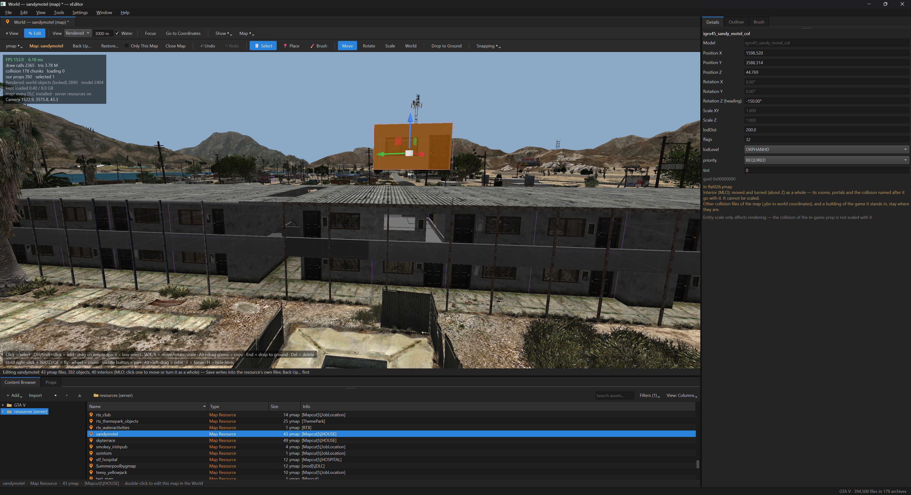 |
| :---: | :---: |
| The game's map with your server's resources on it | A map resource's interior (MLO), moved as a whole |

- **World viewport** — the game's map with its real models and textures (or its collision), in the multiplayer
  version FiveM uses, plus the props, maps and MLOs of your server's resources — only those its `server.cfg` starts
  (its `ensure` / `start` lines, the files it `exec`s, `[categories]`, dependencies). In the Content Browser a
  resource that changes the map is orange and one the World leaves out is grey; right-click one to leave it out of
  the World, or take it in, whatever `server.cfg` says (*Map ▾ → Only what server.cfg starts* switches the rule
  off). **Map ▾** chooses the game alone or with your resources, and the **game build** whose map is shown (the DLC
  packs FiveM loads for that build; the server's own build is marked). Like CodeWalker it loads once: what has been
  read stays loaded while you fly about (up to a memory limit, *Show ▾ → Keep loaded*), and a far model stays until
  the ones that replace it close by are ready. Fly around, click any object to see what it is and which files it
  comes from, *Go to Coordinates…*.
- **Edit mode** — a map editor: place props one at a time or with a brush, move / rotate / scale with a gizmo,
  snapping, undo and redo; drag a model in from the Content Browser. What you place on the game's map is saved as
  a **new `.ymap` of your own** — the game's files are never changed.
- **Your server's maps, where they are** — with the Content Browser's *Map* filter on, every resource that streams
  ymaps is listed by its folder's name; double-click one (or right-click → *Edit Map in World*) and the World tab
  opens all of its ymaps and takes the camera there. Move, turn or delete its objects and add props; *Save* writes
  back only the ymaps that changed, in place (new props go into `<resource>_veditor.ymap`). **Back Up…** copies the
  map to a folder you choose, **Restore…** puts a backup back, **Only This Map** hides the rest of the world.
- **Map Files** — beside the selection, the Details panel has what the map's resource is made of: its ymaps (with
  how many objects each holds), its `.ytyp` files — every archetype, interior, room, portal and entity in them,
  edited right there in a form below the list — its collision, models and textures. Double-click an interior or
  a door to edit it in the World, a ymap to list its objects, a model or collision file to open it. *Archetype
  in ….ytyp* on a picked object goes to its archetype.
- **The Outliner** lists the map's objects by the ymap they are kept in (one ymap or all of them, sorted by any
  column); its right-click menu goes to an object, moves, turns, scales, drops, copies or deletes it.
- **Interiors (MLO)** — an interior placed by the map is one object: click a room and the whole interior is
  picked, moved with the handle and turned about its up axis, its rooms, portals and own collision going with it.
- **Inside an interior** — what an interior is made of (doors, furniture, walls) is in its `.ytyp`, not in the
  ymap. *Edit Interior (ytyp)…* (on an interior picked in a map, in the Outliner, or on any object of an interior
  clicked in the World) opens it where the map places it: its entities are moved, turned, deleted, copied or placed
  with the gizmo, listed by room — doors are most often on the portals. *Save* writes the `.ytyp` in place, by
  CodeWalker's rules for an interior's lists; every place the interior stands shows the change.
- **`.ytyp` files** open in a tab of their own too: the archetypes, an interior's rooms, portals, entity sets and
  timecycle modifiers, and the form of what is picked — names, distances, flags (as named boxes), a time
  archetype's hours, an entity's place, turn, scale and room. Delete, copy, add an entity to a room, undo.
- **Make a Model of This Size…** — the game draws an interior's entity at its model's own size, whatever scale it
  is given. This makes a copy of the model at the size you set — its collision too, by your CodeWalker — adds its
  archetype to the `.ytyp` and gives the entity that model at scale 1.
- **Props and your game build** — every prop knows the game build it came with. The prop list leaves out (or marks
  in orange) props newer than your server's build (`sv_enforceGameBuild`, or the build chosen under *Map ▾*);
  placing one, or saving a map that has one, tells you that players on that build will not see it.
- Not done yet: collision (`.ybn`) laid out in world space does not follow a moved object or interior, and the
  map's far (LOD) models are not rebuilt — a moved object's far model stays where it was. Not tried in game by
  vEditor itself: every ymap and `.ytyp` it wrote was read back by CodeWalker's library.
- **Traffic paths** — *🛣 Paths* (Shift+3, or *Tools → Traffic Paths*): the roads the game's traffic drives on
  (the `.ynd` path nodes of the game and of your resources), drawn over the world — green two-way, orange one-way,
  red where the game makes no traffic, every lane a line of its own with arrows the way it goes (as CodeWalker draws
  them). *Show* buttons on the bar: **Roads**, **Walkways** (the navmesh), **Train Paths** (the train tracks) and
  **Population Zones** (the named zones of `popzone.ipl`, the one the camera is in at the top) — all on at first;
  the tracks and zones are shown, not edited. Pink: the pedestrians' few nodes in those files — where they cross a
  road, and "assisted movement" routes (mostly stairs). Where pedestrians walk about is not in them: that is the
  navmesh. Double-click a `nodes….ynd` in the Content Browser and the World shows its area (a yellow box); *Show in
  Content Browser* in the Details panel goes the other way.
  - **Draw a road** — *Add Nodes*: click the ground, and every click puts down a node joined to the one before; click
    a node to join it, a road to put a node in it, Shift+click to start apart. A road drawn on from the end of
    another takes its lanes; a new one takes the bar's (lanes each way, speed, traffic on or off).
  - **Edit** — drag nodes (or their handle), join two (L), put a node in a road (I), remove a road (U), reverse a
    one-way road (R), drop nodes to the ground (End), delete; double-click a node for its whole road. In the
    Details panel: a node's kind (road, pedestrian crossing, assisted movement), special type (traffic light, stop
    sign, emergency vehicles only …), speed, traffic density and flags; a road's lanes each way, lane offset and
    flags. Undo and redo.
  - **Save Paths** writes each area that changed as a `nodesN.ynd` (an area is 512 × 512 m) into a resource of its
    own — `veditor_paths` in your resources folder, ready to `ensure` — or back into the resource the file came
    from (a copy of what it replaces goes to `.veditor_backup`). An area whose roads lead into a changed one is
    written too: a node's place in its file is part of every link to it.
  - **Walkways (sidewalks)** — *🚶 Walkways* (3): the navmesh, the ground pedestrians walk on, drawn around the
    camera — blue where it is pavement (deeper: more pedestrians), green where peds are made off the pavement, grey
    road, purple interior. Drag to make ground pavement (pedestrians walk about there and are made there, at the
    density chosen, 0 … 7 — the game's own pavements have 1, 3 or 5), Shift+drag to take it away; roads, water and
    steep ground are left alone unless asked. A click on a polygon with *Select* shows all its flags to set by hand.
    The navmesh files (`navmesh[x][y].ynv`, 150 × 150 m each) are saved with the paths, written as they were with
    only the polygons' flags changed — of the game build chosen under *Map ▾*, so choose your server's build first
    (DLC packs change the navmesh). It changes where the existing navmesh lets pedestrians walk; ground the navmesh
    has no polygons on (a new floor of a map of your own) is not made yet.
  - A path file takes the place of the game's whole area. Two resources that stream the same file are marked —
    FiveM uses only one of them. Cayo Perico's own path files are on a switch (*Paths ▾*).
  - Not tried in game by vEditor itself: every path file of the game, read and written again by vEditor, holds the
    same nodes, links and junctions, and CodeWalker reads vEditor's files as it reads the game's (a navmesh file
    vEditor wrote differs from the game's only in the flags changed). Not in it yet: navmesh made new for ground
    that has none, and the heightmaps of new junctions.

### Timecycle Editor

*(the screenshot at the top)*

- A part of the **World** tab, not a tab of its own: **☀ Timecycle** in the World's bar (F6, or *Tools →
  Timecycle*) switches it on and off. On, the world is lit by a timecycle and its bars, the timeline under the view
  and the Timecycle panel come up — and the map is edited as before, in that light.
- The game's light, sky and fog for every **weather × time of day × region**, read from the game and edited with
  the world rendered under it — drag a value or a point of the graph and the picture follows.
- Your changes are kept as a set of your own (`w_*.xml` files of only what differs); the game's files stay as
  they are. Open an existing visual pack's `w_*.xml` to look at it or carry on from it.
- **Export** as a ready-to-use FiveM resource: a *Script Resource* that changes the values while the game runs, or
  an *XML Resource* that sends the `w_*.xml` files to every player (the only way the sky colours change: restart
  that resource, then leave the server and join again). **Send to Game** pushes every change into a running game
  through the Script Resource — with the clock, the weather and a free camera following the program.
- The preview is vEditor's own renderer, not the game's: good for seeing where a change goes, to be confirmed in
  game (clouds and city lights are not drawn, so nights are darker than in game).

In game — FiveM, game build 2612 — one street from morning to night:

| 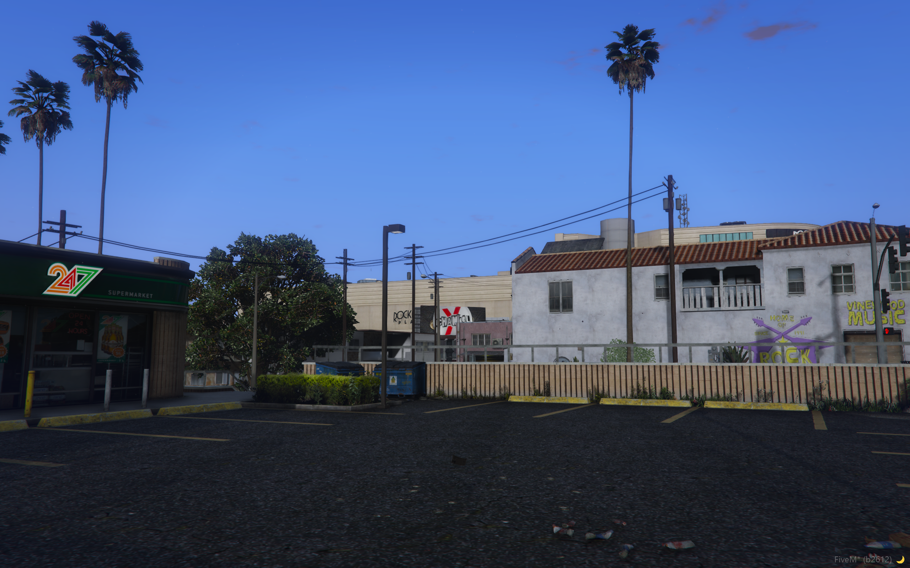 | 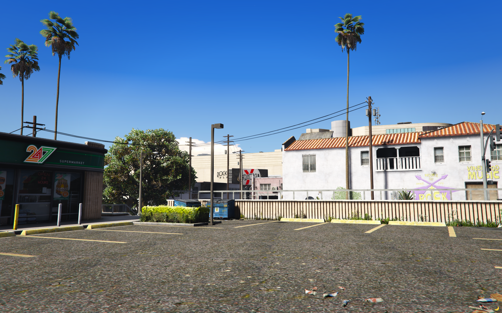 | 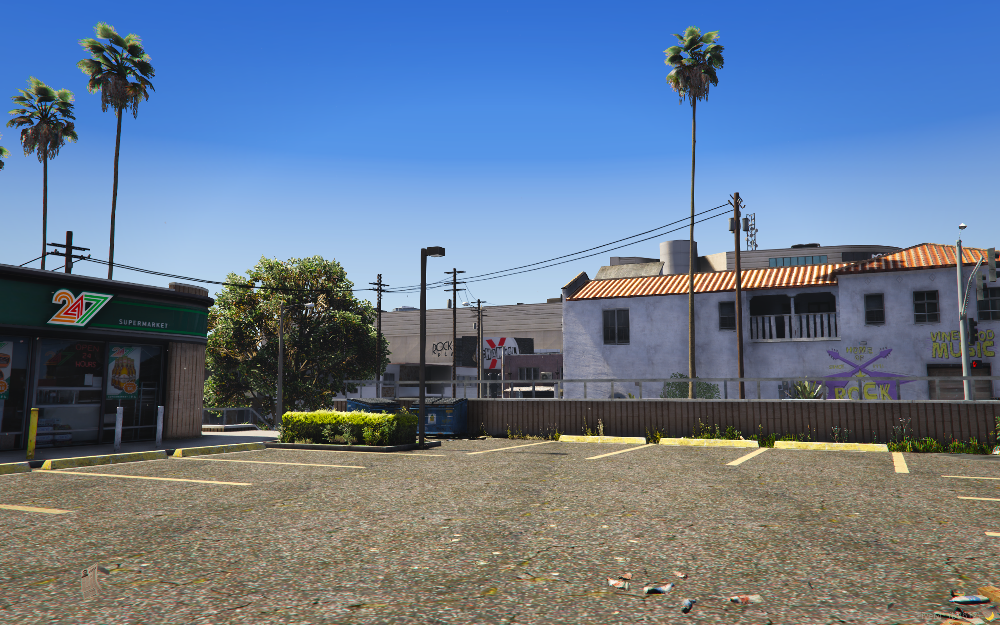 | 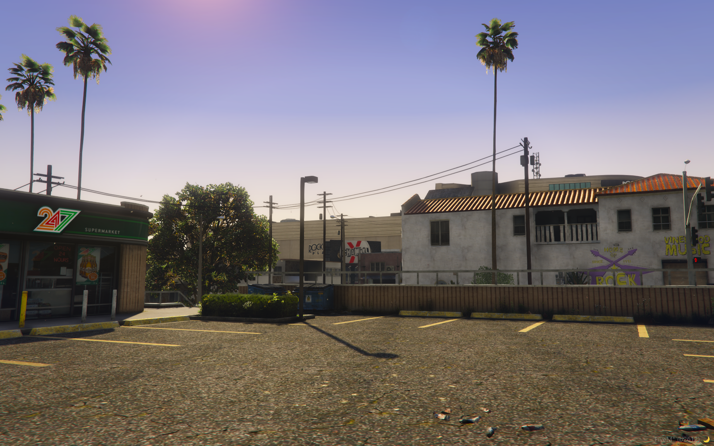 |
| :---: | :---: | :---: | :---: |
| Early morning | Morning | Midday | Afternoon |
| 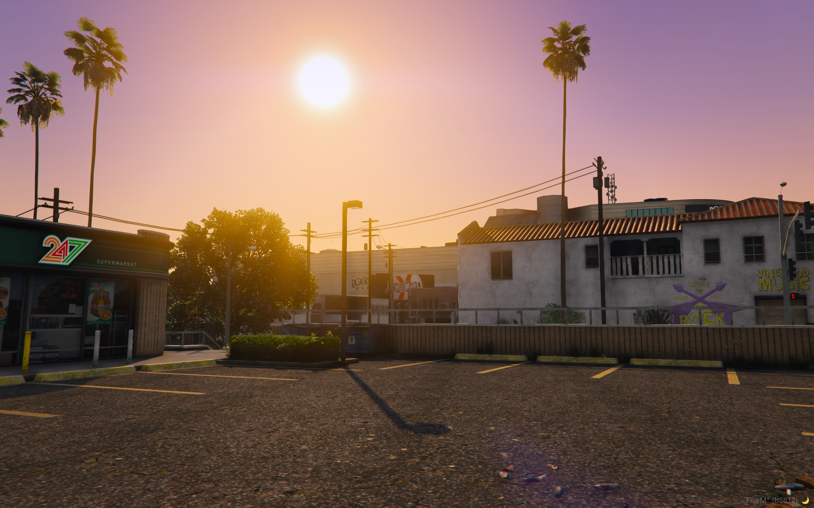 | 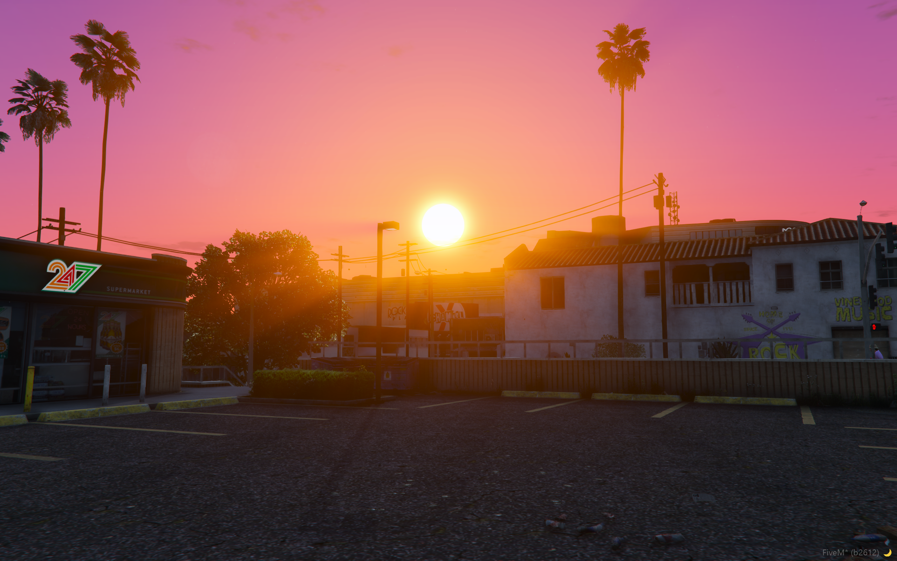 | 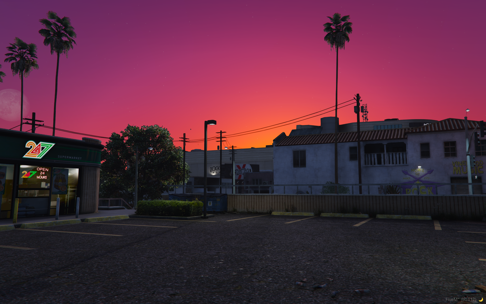 | 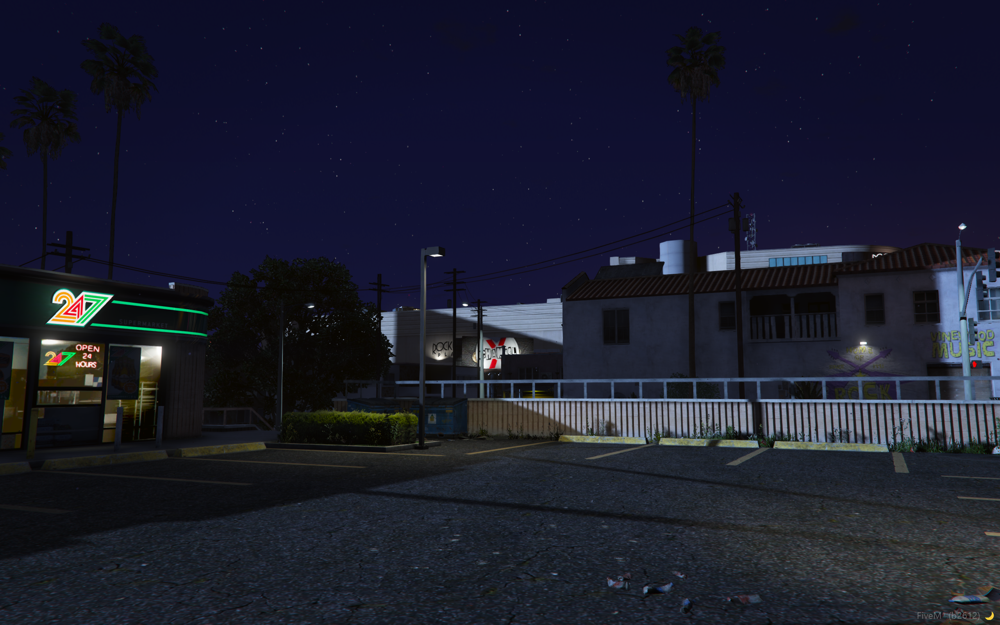 |
| Late afternoon | Sunset | Dusk | Night |

### Animations

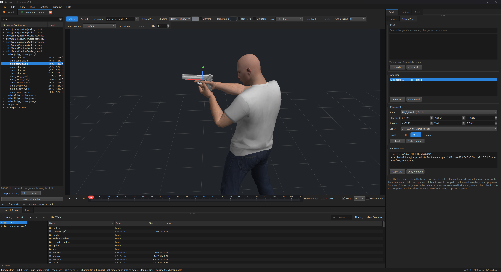

Three tools, each a tab of its own under *Tools*:

- **Animation Library** — every animation of the game (about 20,000 dictionaries) and your own `.ycd` files,
  played on any of the game's characters. Named `dict` + `anim`, exactly as `TaskPlayAnim` takes them. Click an
  animation in the list to play it; **right-click** the list for the rest: *New Animation*, *Edit*,
  *Replace with a File*, *Delete*, *Import*.
  - **Editing** — pick a bone, turn or move it with the handle, and every pose becomes a key; a frame bar, copy /
    paste of poses, undo. *Save* writes the `.ycd` — over your own file, or where you choose for a dictionary of
    the game.
  - **Import and Replace** — bring in `.ycd`, `.fbx`, `.bvh` or keyframe files (several at once). The motion of an
    `.fbx` / `.bvh` — exported from Blender or Unreal, for example — is put onto the game's skeleton for you;
    *Replace with a File* puts it in the place of an existing animation under the same name.
  - **AI Assistant** — describe a motion and get keyframes, or a whole motion from a motion model — see
    [AI](#ai-optional).
- **Animation Capture** — one animation or a whole queue as WebP frames, MP4, WebM, animated WebP or GIF, at any
  size, with a transparent background where the format has one. *Looks* (shading, colour, background, floor grid,
  anti-aliasing) and camera angles can be saved as presets. It also lists what the library is editing, and can
  draw the props placed in Attach Prop.
- **Attach Prop** — put the game's props on bones of the character, place them with a handle, and copy the
  finished `AttachEntityToEntity(…)` line (bone id, offset, rotation, rotation order). *Paste Numbers* shows where
  an existing script puts a prop.

### Cloth Tool

- **Your clothing packs as the game sees them** — the server's packs in `server.cfg` order (or a standalone
  folder), what is in each, and **the number every item has in game**. *Check…* measures the packs against the
  limits of the game build you choose; *Calculate VRAM* estimates the video memory items take when worn; files
  over FiveM's streaming limits are marked blue / yellow / red.
- **Edit Mode** works on the pack's folder itself — no project file, no build step: *New DLC…*,
  *Add Models* (your own files, or **From the Game** — any of the game's clothes, male and female), delete, reorder,
  move to another pack.
- **Per item** — name, component / prop type, behaviour flags, audio preset, first-person model, mesh physics
  (`.yld`), hoodie hairs, and Shop Meta (restriction tags, shop).
- **Textures** — import, replace, export, optimize and delete the variations of an item and the textures embedded
  in its model; a preview of the item on the whole character with the rest of an outfit.
- **UV page** — the item's UV layout beside the 3D model: import or export the picture, export the layout, or have
  an AI model make the texture on that layout.
- **Tattoos** — add a tattoo from a picture or start a blank one, place it on the body in 3D (zone, position,
  scale, rotation, male / female), choose its type; the design can be drawn by AI.

### Weapon Tool

*Tools → Weapon Tool* (Ctrl+Shift+W) — add-on weapons for a FiveM server, saved as a resource that is ready to
`ensure`.

- **Start from a game weapon** — any of the game's weapons, by group, with its name, damage, clip and fire rate
  (a DLC weapon says which game build it needs). The new weapon gets all of its values, components, animations and
  the way a character moves with it, under a **name, slot and model of its own**. Or *Change a Game Weapon*: the
  game's weapon itself with new values, for every player (`WEAPONINFO_FILE_PATCH`).
- **Model** — your `.ydr` (its `.ytd`, `_hi.ydr` and `+hi.ytd` come along, and clip / suppressor models named after
  it — `…_mag1`, `…_supp` — become the weapon's own components), a copy of the game weapon's model to retexture, or
  the game's model as it is. Renaming the model renames its files.
- **Per weapon** — name, the name shown in game, slot and wheel order, group, ammunition, sound, effects; **Stats**
  (damage, headshot and player-vs-player multipliers, fall-off, clip size, fire rate, range, accuracy, recoil,
  the weapon wheel's bars) with the game's value beside every one that differs; **Flags** (every `WeaponFlags`
  value of the game, grouped, with the game weapons that have it); **Components** (keep the game's, make a copy of
  one's own with its own name, model and clip size, add one of the game's); **Animations** and movement taken from
  any game weapon; and the whole `CWeaponInfo` as XML.
- **The server's weapon resources** are listed and open in the same editor — those made by other tools too.
  The check marks what would go wrong in game: a component named like one of the game's (it changes every weapon
  that has it), a model named like one of the game's, two resources with the same weapon or component, a weapon with
  no animations, a template newer than the server's game build, files over FiveM's limits.
- **Save** writes `fxmanifest.lua`, the metas (`weapons`, `weaponcomponents`, `weaponarchetypes`,
  `weaponanimations`, `pedpersonality`), `cl_weaponNames.lua`, the `stream` folder and an `INSTALL.md` with the
  hashes and entries for ox_inventory / qb-core / ESX. What is replaced is copied to `.veditor_backup` in the
  resource first. *Test Command* adds `/give_<resource>` for admins (an ace).
- Not tried in game by vEditor itself: the layout follows the game's own DLC weapon files and the add-on weapon
  resources that run on FiveM servers.

### Vehicle Tool

*Tools → Vehicle Tool* (Ctrl+Shift+V) — the vehicle resources of a FiveM server: the vehicle's model in the middle
as it stands in game ready to drive (with its wheels, stock parts) and its sirens glowing over it, five pages beside
it. Every change can be undone (Ctrl+Z / Ctrl+Y); *Save* writes them into the resource's own folder (what is replaced
goes to `.veditor_backup` first).

| 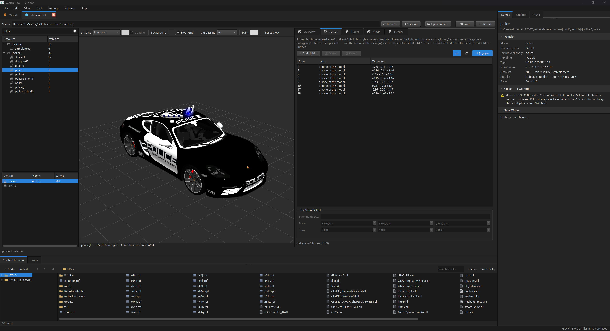 | 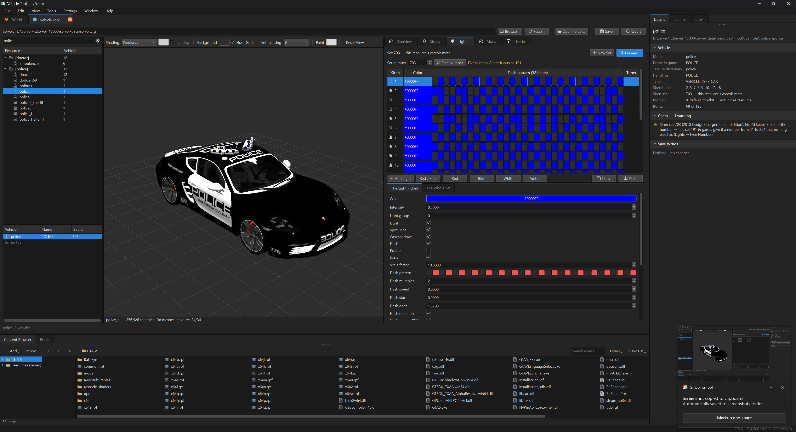 |
| :---: | :---: |
| **Sirens** — the lights on the model, placed with the handle | **Lights** — the siren set: flash patterns, colours, *Free Number* |

- **Sirens on any vehicle** — a siren is a bone `siren1` … `siren20` of the model. *Add Light* puts on a bare light
  (a bone: its light and corona, no lens) or a piece of one of the game's emergency vehicles — a whole lightbar
  (housing, lenses, glass) or a single lens — taken from the game's own model, with the textures it needs. Place it
  with the handle in the view (W move, R rotate, Ctrl for 1 cm / 5° steps) or by typing; *Mirror* copies it to the
  other side; the bones the model already has move the same way (with their lens). *Delete* (the key, or right-click)
  takes a siren off — one of the model's own goes with its lens when saved. Save puts the bones and the geometry into
  `<car>.yft` and `<car>_hi.yft` through CodeWalker's library (as Export / Import XML does).
- **Lights** — the vehicle's siren set: each light's color, its 32-beat flash pattern (click / drag the cells,
  right-click for patterns), turning, corona, intensity; the set's speed and cone. *Preview* (on this page and on
  Sirens) flashes them on the model. A set of the game's (or of another resource) is read only until *Make It This
  Resource's* copies it. The set's number is checked against the game's and the server's: FiveM keeps 8 bits of it,
  so two sets that agree in those are one set in game — *Free Number* gives one from 21 … 254 that no one has.
- **Mods** — what the mod shop has for the vehicle, slot by slot; click a part and it is on the car in the view
  (the stock part it replaces hidden), *Stock* takes them off; the extras can be switched off. The upgrades that need
  no model: Engine, Brakes, Transmission, Suspension, Armour (the game's usual levels with one click, or levels of
  your own). A vehicle without a kit of its own gets one with an id no kit of the game or the server has.
- **Liveries** — the livery textures of the `.ytd` (`…_sign_1`, `_sign_2` …) and what FiveM's server says of the
  `.ytd`'s size (its blue / yellow / red marks, "Oversized assets…"): when it is large it says to add liveries as
  **livery mods** instead — `.yft` files of their own, loaded only when the livery is put on
  (`SetVehicleMod(vehicle, 48, index)`). *Add from Pictures…* makes them, *Make a Livery Mod of It* turns a
  `_sign_` texture into one; their names in the shop go to `veditor_labels.lua`. *Add New* makes a livery mod
  whose picture is the vehicle's **UV template** (the panels' outlines, see-through between them), *Duplicate* a
  copy of one. A double-click on a livery of either kind (one not saved yet too) opens it as a picture — ← / → to
  the next, *UV Template* over it on / off, *AI Generate* (the template and your words to the AI model chosen;
  its picture is shown first: put it in this livery, add it as a new one, or discard it), *On the Car*, *Edit in
  Image Editor* (the template as a guide layer; its Save puts the picture back, written with the resource),
  *Duplicate*, *Open File*, *Export PNG…*.

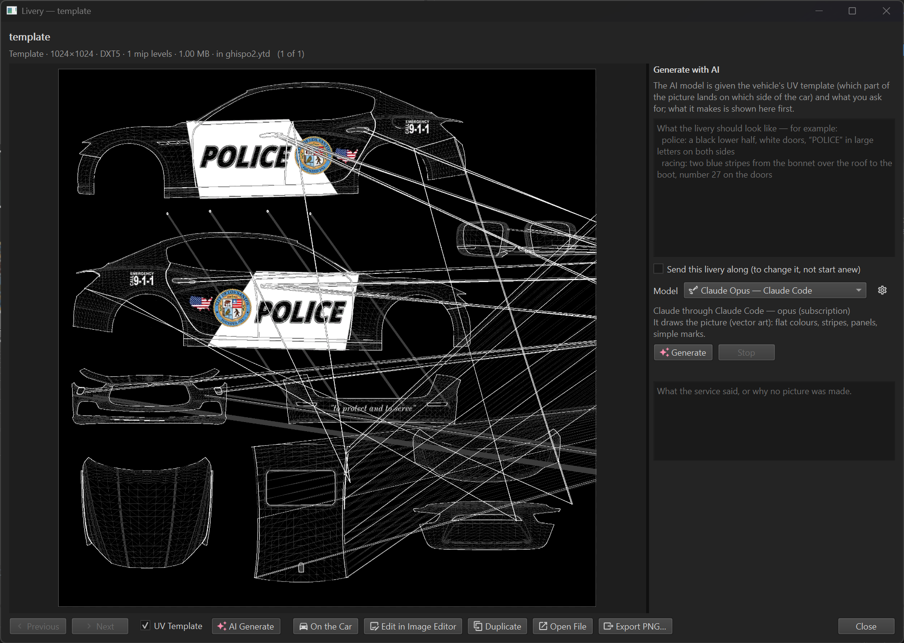

- Not tried in game by vEditor itself: the files were read back by vEditor and CodeWalker; the siren pieces, bones
  and livery mods are built like the game's own (police3, polgauntlet, buccaneer2 …).

### Scaleform (GFx) viewer

- Opens `.gfx` movies (HUD, menus, minimap, fonts) read-only: every symbol, sprite, shape, text field and font,
  timeline playback, the textures pulled from the matching `.ytd` of the game, the function names found in its
  ActionScript, *Export PNG…*.

### AI (optional)

*Settings → AI Models…* lists the models vEditor may ask; wherever something is generated you choose one of them.

| For | Kind of model | What comes back |
| --- | --- | --- |
| Textures, tattoo designs | a **picture model** — OpenAI `gpt-image`, Gemini *Nano Banana* | a painted picture: cloth, prints, shading, detail |
| Textures, tattoo designs | a **model that writes** — Claude, GPT, Gemini | a drawing (vector art): flat colours, stripes, lettering — sharp and exactly on the UV layout |
| A part of a picture (Image Editor) | either of the two above | a picture model: that part painted anew or changed, fitted to what is around it; a model that writes: a drawing laid over it, see-through where nothing is drawn |
| Animations | a **model that writes** — Claude, GPT, Gemini | keyframes: poses, gestures, changes to the open animation |
| Animations | a **motion model** — Meshy *Text to Motion*, Uthana | a whole-body motion from one sentence, as a new animation |

- **Claude** runs on your Claude subscription through [Claude Code](https://claude.com/claude-code) installed on
  the computer, or with an API key. **OpenAI, Gemini, Meshy and Uthana** need an API key of your own.
- Not yet tried with real keys: the routes to OpenAI, Gemini, Meshy and Uthana are written from those services'
  documentation and tested against stand-ins only. Claude through Claude Code is the route the sample videos use.

## Download and install

vEditor runs on **Windows 10 / 11 (64-bit)** and needs **GTA V** installed for everything that shows the game's
files (it also opens without the game: *Continue Without the Game*). It is made for GTA V Legacy, the version FiveM
runs; GTA V Enhanced is found and read too, but its textures use a newer format the texture tools do not read yet.

1. Download `vEditor-<version>-win64.zip` from the
   **[latest release](https://github.com/vEditor-cmyk/vEditor/releases/latest)**.
2. Unzip it anywhere — it gives a `vEditor` folder — and run `vEditor.exe` in it. Keep the `_internal` folder
   beside it: the program is made of both.
3. The first time, Windows may show **"Windows protected your PC"**: vEditor is not signed with a paid
   certificate, so Windows does not know it yet. Click **More info → Run anyway**.

To be sure the download is the one published here, compare its SHA-256 with the `.sha256` file on the release
page: in PowerShell, `Get-FileHash .\vEditor-<version>-win64.zip`.

**Updating** — vEditor tells you when a newer version is out (it never updates itself). Download the new zip and
unzip it in place of the old folder: your settings, API keys and caches are kept, since they are not in that
folder. *Help → About* shows the version you have; [CHANGELOG.md](CHANGELOG.md) says what changed.

**Optional extras**

- [CodeWalker](https://github.com/dexyfex/CodeWalker), installed — for *Export / Import XML* and the Vehicle Tool's
  sirens (vEditor drives its library).
- [ffmpeg](https://ffmpeg.org) — for MP4 / WebM / GIF captures in Animation Capture (WebP needs nothing).
- [Claude Code](https://claude.com/claude-code) — for AI on a Claude subscription.

## Good to know

- **Keep backups and try things on a test server first.** What vEditor writes is checked by reading it back — with
  its own readers and, for the game's formats, against CodeWalker's library — but not all of it has been tried
  inside the game yet.
- **The game's files are not changed** unless you edit an archive yourself: editing inside an `.rpf` writes at
  once, so vEditor asks first and offers a `.bak`.
- The 3D views are vEditor's own renderer. They are close to the game, not the game.

## Credits

- **[CodeWalker](https://github.com/dexyfex/CodeWalker) by dexyfex** — vEditor reads and writes the game's formats
  the way CodeWalker does, ported from its source, and it includes CodeWalker's `magic.dat` (the data that opens
  the game's archives, unchanged). vEditor would not exist without it: thank you, dexyfex, and everyone who worked
  on CodeWalker. GTA V's encryption code it builds on is by Neodymium (MIT).
- vEditor is built with [Qt for Python (PySide6)](https://www.qt.io/qt-for-python), used under the LGPLv3, and other
  open-source software. Their licences are in `THIRD-PARTY-NOTICES.txt` in the download (also *Help → About →
  Third-Party Notices*).
- vEditor is free to use; it is not open source.
- vEditor is a fan-made tool and is not affiliated with Rockstar Games, Take-Two Interactive or Cfx.re.
