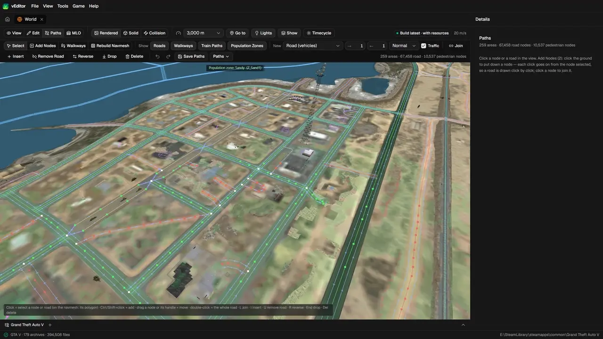
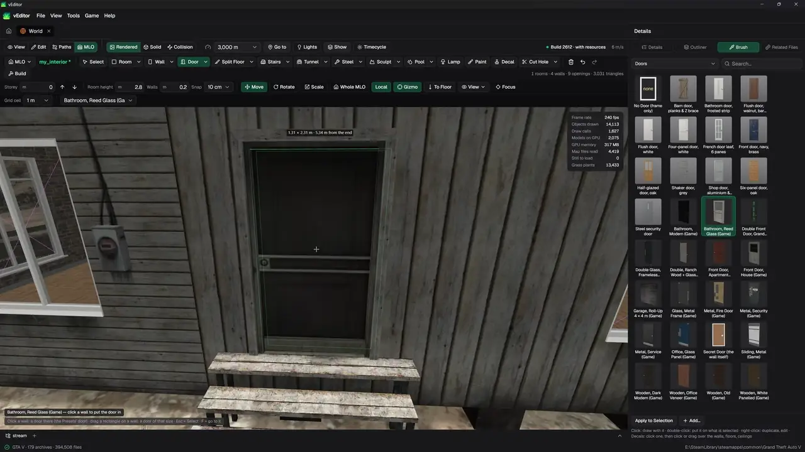
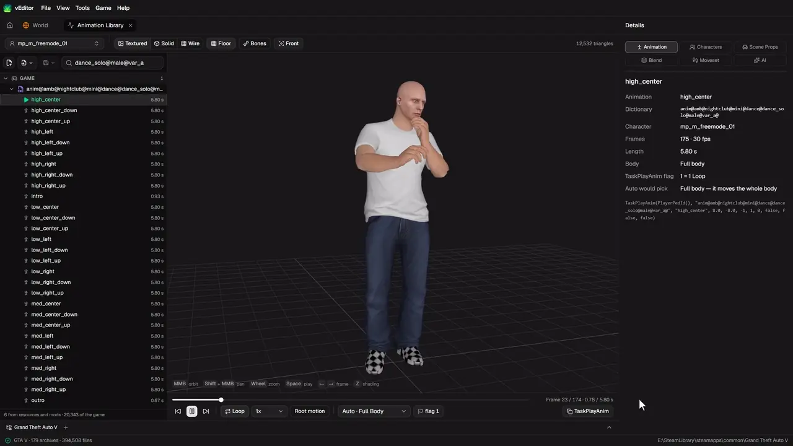
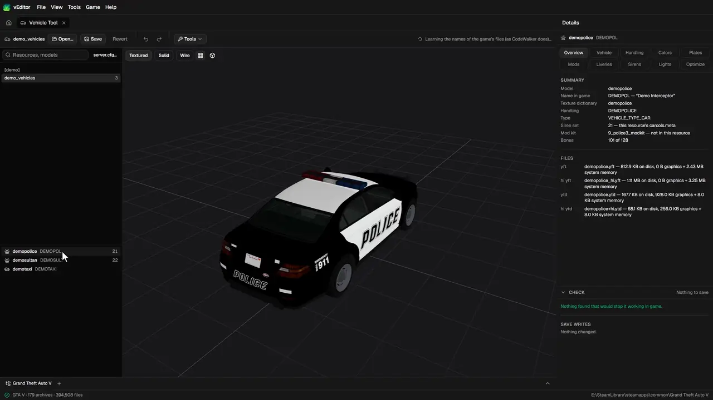
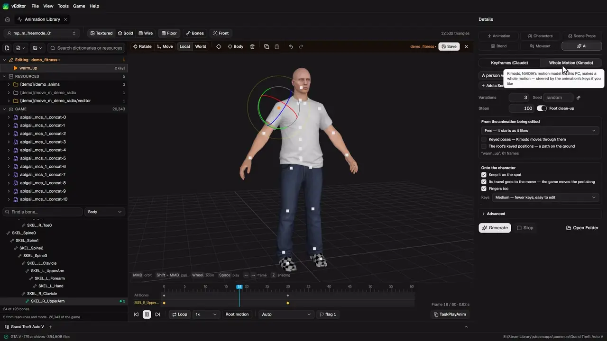

# vEditor

**One window for GTA V / FiveM assets** — textures, models, props of your own, the map and its traffic paths,
interiors (MLOs) of your own, the colours of the radar and the pause map, timecycles, animations
and walk styles, clothing, tattoos, weapons and vehicles — reading the game's own files directly, with no
extracting first.

**[⬇ Download the latest version](https://github.com/vEditor-cmyk/vEditor/releases/latest)** — Windows, free ·
[what is new](CHANGELOG.md) · [how to install](#download-and-install)

vEditor is made for convenience: the everyday jobs of a FiveM server in one program instead of a handful.
I will keep adding tools as far as I can.

- **Free.** Everything in vEditor is free to use. The one exception is AI from an online service: vEditor sells no
  AI of its own — it asks the service you choose, on your own subscription or API key, and that service bills you.
  Kimodo, the motion model that runs on your own computer, costs nothing. Every AI feature is optional. If vEditor
  saves you time and you would like to support it, you can [buy me a coffee](https://buymeacoffee.com/veditor) —
  never needed, always appreciated.
- **Private.** No account, no telemetry, nothing sent to a server of mine. vEditor goes online only to check
  GitHub for a newer version once at start (the checkbox in *Help → Check for Updates…* switches it off; nothing is ever
  downloaded or installed by itself), when you press **Generate** on an AI feature, for downloads you start
  yourself (the video pose model, Kimodo), and to talk to your own FiveM server when you ask it to. Settings, API
  keys (encrypted by Windows for your account) and caches stay on your computer.

## The tools at a glance

| Tool | Where | What it is for |
| --- | --- | --- |
| [Content Browser](#content-browser-and-the-games-files) | along the bottom of the window | the game's files, your server's resources and any folder, `.rpf` archives opened like folders |
| [XML](#xml-as-codewalker-makes-it) | right-click a file | CodeWalker's XML of any file, and back again |
| [Textures](#textures) | a `.ytd`, `.ydr`, `.yft`; *Tools → Texture Batch* | view, replace, optimize and shrink textures |
| [Image Editor](#image-editor) | *Tools → Image Editor* | a picture editor laid out like Photoshop, with AI |
| [Models](#models) | double-click a model | the model with its textures, bones, collision and materials |
| [World and Map Editor](#world-and-map-editor) | the World tab (Shift+1 / Shift+2) | the game's map with your server's maps on it; place, move and remove objects |
| [Traffic Paths](#traffic-paths) | World, Shift+3 | the roads traffic drives on, sidewalks, the navmesh |
| [MLO Tools](#mlo-tools) | World, Shift+4 | interiors of your own, built as in The Sims, with the ground and water around them |
| [Timecycle Editor](#timecycle-editor) | World, F6 | the game's light, sky and fog by weather and time of day |
| [Map Colours](#map-colours) | *Tools → Map Colours* | the radar and the pause map in colours of your own |
| [Animations](#animations) | *Tools → Animation Library* | play, edit, blend, import, capture; walk styles; props on bones; seats |
| [Cloth Tool](#cloth-tool) | *Tools → Cloth Tool* | clothing packs, item numbers, tattoos, pictures of clothes |
| [Weapon Tool](#weapon-tool) | *Tools → Weapon Tool* | add-on weapons, skins, attachments |
| [Vehicle Tool](#vehicle-tool) | *Tools → Vehicle Tool* | sirens, liveries, mods, plates, handling, new vehicles |
| [Prop Tool](#prop-tool) | *Tools → Prop Tool* | your OBJ / FBX / glTF models made into props |
| [3D Editor](#3d-editor) | *Tools → 3D Editor* | a model's mesh and its collision edited as in Blender |
| [AI](#ai-optional) | *File → AI Models…* | textures, tattoos, liveries and animations made by AI — all optional |

## Features

Under each part, a short silent clip of it in use — click one for the 1080p video.

### Content Browser and the game's files

- **Reads the game directly** — every file of GTA V can be found by name (the Content Browser's search), opened or
  exported, with nothing to extract first. The game's own files are only read, never changed.
- **Content Browser** — the GTA V folder, your server's `resources` folders and any folder you add, side by side;
  `.rpf` archives open like folders. Grid or List, a colour per file type, search through everything
  below a folder (archives included), filters by type.
- **Work with files** — New Folder, Import, Rename, Delete and Export, on disk and inside archives; drop files in
  from Explorer; right-click to make a new animation (`.ycd`) or texture dictionary (`.ytd`).
- **Tabs** like a web browser's — each keeps its folder, search and selection, and they are there again next time.
- **Reload Map** — right-click a resource to see its map as it is now, without loading the whole world again.
- **RPF Explorer** (*Tools → RPF Explorer*) — open or create an `.rpf`, import and export files and folders, nested archives,
  rename, delete, defragment; textures inside an archive are edited and saved back in place.
- **Code editor** — `.lua`, `.meta`, `.xml`, `.json`, `server.cfg` and other text files in a tab, coloured as in VS
  Code: folding, find and replace, comment out (Ctrl+/), copy and move lines, zoom. A backup is kept the first time
  you save.

The Content Browser: the demo server's resources, a folder opened, Grid and List view, a new browser tab, a search of the whole game and a prop from the results opened in 3D.

### XML, as CodeWalker makes it

- **Export XML** — CodeWalker's XML of any file (textures as `.dds`, sounds as `.wav`), the XML Sollumz and
  CodeWalker read: `.ydr .ydd .yft .ytd .ycd .ybn .ymap .ytyp .ymt .ymf .ynd .ynv .ypt .awc .rel` and more.
- **Import XML** — `x.ydr.xml` → `x.ydr`, into a folder or straight into an archive.
- **Edit Code (XML)** — a `.ymap`, `.ytyp`, `.ymt`, `.ynd` … opened as XML, edited and saved back into the file;
  mistakes are shown at their line and nothing is written.
- Uses the CodeWalker installed on your computer (see [Download and install](#download-and-install)).

A .ytyp opened as CodeWalker's XML (Edit Code), its draw distance changed in the code editor and saved back into the file, then a model exported as XML.

### Textures

- **Texture dictionaries and embedded textures** (`.ytd`, `.ydr`, `.yft`) — size, format and mip levels of every
  texture, a preview, Import, Replace, Export (PNG or DDS), Delete. Imports PNG, JPG, WebP, BMP, TGA, GIF, TIFF and
  DDS.
- **Optimize** — DXT1 / DXT3 / DXT5 (or let vEditor choose), mip levels, power-of-two sizes, downscaling — one
  texture or many at once, transparency kept right.
- **Really smaller files** — a model saved after its textures shrink gets smaller too, and so does the memory the
  server reports.
- **No flickering textures** — every compressed texture is kept to the sizes the game can load.
- **Texture Batch (Folder)** — every texture of every file in a folder in one list; filter, then convert all or a
  selection, over the originals (with a backup) or into a new folder.
- **AI…** and **Edit…** (in the [Image Editor](#image-editor)) on any texture.

A texture dictionary of the game: its textures and every mip level, a picture imported into it, then Texture Batch converting a whole folder.

### Image Editor

A picture editor laid out and driven like Photoshop, in a tab of its own.

- **Tools with Photoshop's keys** — Move, Marquee, Lasso, Magic Wand, Crop, Eyedropper, Brush, Pencil, Clone Stamp,
  Eraser, Gradient, Paint Bucket, Type, Shapes, Hand, Zoom; Free Transform (Ctrl+T); snapping to edges and layers.
- **Layers** — 23 blend modes, opacity, locks, editable type layers, **Layer Style** (stroke, shadows, glows,
  overlays), merge, flatten.
- **Adjustments and filters** — Levels, Hue/Saturation, Color Balance, Exposure, blurs, sharpen, noise, emboss, high
  pass and more, previewed live.
- **AI on a part of the picture** — select an area, type what should be there (or nothing, to fill it in), and the
  answer comes back as a new layer.
- **Made for textures** — Pattern Preview for tiling textures, the UV layout as a guide, **Generate Normal Map** the
  way the game's normal maps are made, *Flip Green* for normal maps from Blender or Unity; *Save* puts the picture
  back into the texture.
- **Files** — its own `.vimg` keeps the layers; PNG, JPG, WebP, TGA, BMP, TIFF, GIF and DDS; opens simple `.psd`.

A game texture in the Image Editor: Hue/Saturation changing the picture live, a type layer, then Generate Normal Map with its lit view.

### Models

- **Model viewer** for `.ydr`, `.yft` and `.ydd` with their textures — moves as in Blender; Wireframe, Solid,
  Material Preview and Rendered shading.
- **Bones** — the skeleton as a tree; hide any part of the model by its bone.
- **Vehicles** — the textures found as the game finds them, the paint in any colour, every livery.
- **UV Page** — any texture laid out on its UV map next to the model wearing it: paint it in the Image Editor,
  import a picture or have AI make one, then replace the texture or add it as a new livery.
- **Collision** — `.ybn` files in 3D coloured by material; a model's own collision shown over it; **Edit
  Collision…** gives a model a collision of its own (a box, a box per piece, its own shape, or boxes you place),
  with the game's materials.
- **🎨 Materials…** — every shader value of the model with its name and help; drag a value and the view follows;
  saved into the model.
- **☀ Daylight…** — fixes interior pieces placed outside that look black by day.

A car of the game in the model view: turned with the middle mouse button, Blender's Z pie for Wireframe and Rendered, its collision, its materials and a texture's UV layout.

### World and Map Editor

- **The game's map with your server on it** — the real models and textures of the multiplayer map, plus the
  props, maps and MLOs of the resources your `server.cfg` starts. Fly around, click
  any object to see what it is and which files it comes from.
- **Edit mode** — place props one at a time or with a brush, move / rotate / scale with a gizmo, snapping, undo and
  redo, drag models in from the Content Browser. What you add to the game's map is saved as a `.ymap` of your own.
- **Edit your server's maps in place** — open a resource's map, move, turn or delete its objects, add props, save;
  **Back Up**, **Restore** and **Only This Map** (hides the rest of the world).
- **Map Files** — a map resource's ymaps, `.ytyp` files (archetypes, interiors, rooms, portals, entities),
  collision, models and textures, edited right in the Details panel.
- **Interiors** — an MLO is moved and turned as one piece; **Edit Interior** moves, adds and deletes the furniture
  and doors inside it.
- **`.ytyp` editor**, **Outliner** (objects by ymap), **flags as named boxes**, **Open where it comes from** for
  any object.
- **Make a Model of This Size…** — a scaled prop as a real model of that size, collision included.
- **Props and your game build** — props newer than your server's build are marked, with a warning before you use
  them; **Add to Folder…** copies props into a resource of yours under names of their own.
- **Prop pictures** — the Props list as thumbnails; **Prop Capture…** takes pictures of many props at once (PNG,
  JPG or WebP, see-through or on a colour).
- **Manifest (.ymf)** — the `_manifest.ymf` an MLO needs, made from the resource's own files.
- **💡 Night lights** — windows, signs, street lamps and the city's far lights at the hours the game switches
  them on; click a light to find its object, or delete it.
- **Remove from Game…** — take a building or an interior of the game's map out, with its far models and lights,
  saved as a resource of its own.
- **Occluders** — *Show ▾ → Occluders* shows the map's occlusion in colour: what makes a player or an interior
  vanish from some camera angles.

The World at Vespucci Beach: the demo server's map opened in Edit mode, a prop picked and moved with the gizmo, a bench placed from the Props page, the Outliner.

### Traffic Paths

*🛣 Paths* in the World (Shift+3) — the roads the game's traffic drives on, drawn over the world.

- **See** roads (two-way, one-way, no traffic, every lane with its direction), walkways, train tracks and
  population zones.
- **Draw roads** — click to lay nodes; join, split, reverse and delete roads; set lanes, speed, traffic density,
  traffic lights, stop signs and flags. Undo and redo.
- **🚶 Walkways** — paint where pedestrians walk and how many there are, or take sidewalks away.
- **🧱 Rebuild Navmesh** — the ground pedestrians walk on made anew for an area you changed (a plaza where
  buildings were taken away, a new floor). Seen in game: pedestrians walking there.
- **Save Paths** — as a resource of its own, ready to `ensure`, or back into the resource the paths came from.

Paths mode over Sandy Shores: a road node picked (its lanes and flags in the Details) and moved, a new road added with Add Nodes, pavement painted with Walkways.

### MLO Tools

*Tools → MLO Tools* — an interior (MLO) of your own, drawn where it stands on the map and built as
a FiveM resource.

- **Start anywhere** — *🏠 MLO ▾ → New MLO…* and click the spot on the map; look in with the outside, ceilings and
  upper storeys hidden.
- **Build as in The Sims** — rooms (rectangles or any outline), walls on a grid — dragged cell by cell, at 45°,
  curved, full, half or knee high — each cell pushed in or out and painted; floors painted cell by cell; platforms,
  basements, a foundation; storeys with PgUp / PgDn. Dragging is real-time.
- **Stairs** — straight, L, U and spiral, with railings; a straight stair as a closed tunnel down to a basement.
- **Roofs, fences, columns and window shutters.**
- **🚇 Tunnels and 🪜 shafts** — tunnels drawn as a path, shafts up to a manhole with a ladder to climb, chambers
  where they meet.
- **Doors and windows** — 18 of the game's doors or doors made to fit, windows with or without glass; frame on,
  off, or none at all. **Fit to the Building's Doorway** sizes a door to the doorway of the house around it —
  without stretching it.
- **A house of the game, opened up** — cut doors, windows and holes through a building of the map, delete faces,
  and drag its corners with **⬚ Points**; the game's files are never changed.
- **🩹 Decals** — stains, cracks, dirt and signs stamped or painted over any surface, as in Unreal Engine.
- **🔧 Pipes and 🏗 steel** — pipes, ducts, conduit and cable trays along walls and ceilings with bends and fixings;
  ceiling grids, I-beams, trusses and tubes.
- **The ground and water around it** — ground brushes as in Unreal Engine 5 (Sculpt, Smooth, Flatten, Ramp,
  Paint), the game's grass shown or taken away, **pools** with a ladder, **ponds**, **waterfalls** and **rivers**.
  Swimming seen in game.
- **Materials** — photo-real wood, tiles, stone, marble, brick, concrete, plaster and metal at real sizes, in four
  looks (Modern, Everyday, Run-down, Underground); duplicate and edit them, add your own, or have AI make one.
- **Easy editing** — gizmo (W / E / R), the handle on any corner dot, copy a room beside another or to the storey
  above, Alt+drag to copy, the grid turned to a room at an angle, undo and redo.
- **Build** (Ctrl+B) — a FiveM resource ready to `ensure`: the interior with its rooms, portals, models, textures,
  collision, its far (LOD) model and manifest. *Problems* lists what would go wrong in game, with a button to fix
  it. Seen in game: an interior built inside a house of the game, walked into through its doors.

A house of the game opened up: its painted door made a real one, then swapped for another from the Brush; a room drawn inside, its walls and floor painted; a window put in and sized; a tunnel with a ladder up to a manhole; a swimming pool sunk into the ground and its water recoloured.

### Timecycle Editor

- **☀ Timecycle** in the World (F6): the world lit by the timecycle you edit — every **weather × time of day ×
  region** — drag a value or a point of the graph and the picture follows.
- **Your own set** — only what you change is kept; open an existing visual pack to look at it or carry on from it.
- **Export** as a ready-to-use resource: a *Script Resource* that changes the values while the game runs, or an *XML
  Resource* that also changes the sky colours.
- **Send to Game** — every change pushed into your running game as you make it, with the clock, the weather and a
  free camera following vEditor (F2 in game switches back to your own view).

The World lit by the Timecycle over the city: a foggy weather and back, the day scrubbed to sunset, then the time running into the night.

### Map Colours

*Tools → Map Colours* — the map of the radar and the pause map in colours of your own, built as a FiveM resource.

- **Every colour of the map** — land, city blocks, main and minor roads, freeways, tunnels, railway, water depths,
  the open sea. Presets: the game's, vEditor's own, and every Tailwind CSS palette, dark or light.
- **Hillshade** — the land shaded from the game's own heights, flat like a printed atlas or smooth.
- **Zones** — areas you draw (the city, a beach, a desert) in colours of their own.
- **Roads, texts and postal codes of your own** — draw roads, write words in any font and language, import postal
  codes from a `postals.json`, CSV or Lua list.
- **Cayo Perico and Fort Zancudo** in the same colours; the military base built into the map itself.
- **Maps from resources** — build on a resource that adds roads to the map.
- **Build** a resource ready to `ensure`; **Export PNG** of the whole map, 1080p up to 8K.

Map Colours: the game's map with a ready-made palette and more hillshade, then a zone drawn and a text put on the map.

### Animations

Four tools under *Tools*: **Animation Library**, **Animation Capture**, **Attach Prop** and **Interact Object**.

**Animation Library**

- **Every animation** — the game's (about 20,000 dictionaries), your server's resources, the `mods` folder and
  your own `.ycd` files, played on any of the game's characters; names exactly as `TaskPlayAnim` takes them.
- **Upper body (flag 49)** — see an animation as `TaskPlayAnim` flag 49 plays it; *Auto* tells you which flag an
  animation needs.
- **Edit** — pose bones with the handle, keys on a timeline, many keys edited at once, mirror left ↔ right, thin
  out keys, smooth the back, copy and paste animations between dictionaries; save as `.ycd`.
- **Import** `.fbx`, `.bvh` and `.ycd` — motion from Blender, Unreal or Mixamo put on the game's skeleton —
  and **Replace** an animation with a file.
- **Motion from a Video** — a video of a person (a phone clip) turned into an animation, on your own computer.
- **AI Assistant** — describe a motion and get it as keyframes or as a whole motion (see [AI](#ai-optional)).
- **Characters** — up to 8 more characters in the scene, each with its own animation, standing free or attached to
  the first (a carry, a hug, a handshake); copy the Lua for both.
- **Scene Props** — a chair, sofa or table set down around the character to pose against.
- **Blend** — mix an animation into a movement part by part (head, chest, arms, legs) — talking on a radio while
  running, for example.
- **Walk Style** — a whole walk style (idle, walk, run, sprint, starts, stops, turns) made from the game's with your
  layer on top — a radio, a phone — with cover, two-handed weapons and every vehicle seat; exported as a resource
  ready to `ensure`. Seen in game.

**Animation Capture** — one animation or a whole queue (a dictionary, a resource, everything) as WebP frames, MP4,
WebM, animated WebP or GIF, any size, with a transparent background; looks and camera angles saved as presets.

**Attach Prop** — put props (the game's, your resources', your mods') on a character's bones, place them with the
handle, and copy the `AttachEntityToEntity` line — or your own config line with **Copy Custom**. **In Game**
shows the props on your character in your running game as you move them, escrow-locked props too.

**Interact Object** — a bench, a chair or a sofa and its seats for a sit script: place the character on each seat,
give each seat its animations, and copy the finished Lua config with an example script.

A dance of the game, a handshake played by two characters, a bone posed by hand, a walk with the hands up (Blend), a phone in the hand, three seats on a bench.

### Cloth Tool

*Tools → Cloth Tool*

- **Your clothing packs as the game sees them** — in `server.cfg` order, with **the number every item has in
  game**; checks against the game's limits, VRAM estimates, FiveM's size warnings.
- **Edit Mode** — new packs, add models (your files or **any of the game's clothes**), delete, reorder, move between
  packs, copy or move items to the other character.
- **Per item** — type, flags, audio, first-person model, physics, shop settings; **Change Type** (a prop into a hat,
  a component into a prop) moves the model to the right bone.
- **Duplicate check** — tells you when a model is already in a pack.
- **Textures** — import, replace, export and optimize, previewed on the whole character with an outfit.
- **UV page with AI** — the item's texture made on its UV layout.
- **Tattoos** — from a picture or drawn by AI, placed on the body in 3D.
- **Cloth Capture** — pictures, GIFs or videos of clothing items, alone or worn, one or a whole pack, named by
  their number in game (as fivem-greenscreener names them).

The Cloth Tool: the demo server's clothing pack, a varsity jacket's Details, then Preview on Character — turned round, another texture, walking.

### Weapon Tool

*Tools → Weapon Tool* — add-on weapons saved as a resource ready to `ensure`.

- **Start from any game weapon** — its stats, components, animations and movement, under a name, slot and model
  of your own; or change a game weapon itself for every player.
- **Everything editable** — names, stats (with the game's value beside each), flags, components, animations,
  first-person camera per scope, the whole XML.
- **3D view with attachments** — clips, scopes, suppressors, flashlights and finishes put on; move the attach
  points (sockets) and save them into the model.
- **Skins** — a finish made like the game's own (Platinum Pearl Deluxe): a picture, a colour, a skin pack's
  texture, or a model of your own; shared between weapons with the same model.
- **Checks** — warns about names that clash with the game's, missing animations, files too large, textures the
  game cannot load.
- **Save** — the resource with its metas, names, and an `INSTALL.md` for ox_inventory / qb-core / ESX, plus a
  give command for testing.

The Weapon Tool: a weapon resource with its components on the weapon in 3D, then a new weapon made from a game weapon.

### Vehicle Tool

*Tools → Vehicle Tool* — your server's vehicles, the model in 3D with its pages beside it; undo
for every change, backups before saving.

- **Sirens on any vehicle** — bare lights, or lightbars and lenses taken from the game's emergency vehicles,
  placed with the handle, mirrored.
- **Siren lights** — colours, 32-beat flash patterns, preview on the model, a siren set number no one else uses.
- **Mods** — every mod shop part tried on the car, upgrades, a mod kit of its own.
- **Liveries** — livery textures and livery mods, made from pictures, on the vehicle's UV template, by AI, or in
  the Image Editor.
- **Plates** — take a plate off, put the game's plate on, add a front or rear plate, move and turn it.
- **Vehicle, Handling and Colors** — names, engine sound (import a sound pack), class, flags, every handling value
  beside the game's, colour combinations.
- **Optimize** — the vehicle's textures compressed and capped (one vehicle went from 304 to 47 MiB).
- **Tools ▾** — *Check All Vehicles* (clashes, missing files, large textures — as a CSV), **New Vehicle from
  Game** (a game vehicle as a new one, with its mod parts renamed too), *Rename Vehicle*, a probe that reads what
  the game has for your vehicles.

The Vehicle Tool: the demo server's police car — its overview, its sirens flashing in 3D, then its colours, handling and plates pages.

### Prop Tool

*Tools → Prop Tool* — models of your own made into props of the game.

- **Bring in** `.obj`, `.fbx`, `.gltf` / `.glb` with their pictures — several at once.
- **Ready for the game** — sized and stood up, the right shaders (solid, cut-out, glass, glowing), collision and
  draw distance.
- **Save** the files, or a **resource ready to `ensure`** with a command to place props in game (admins only).

The Prop Tool: two OBJ models brought in beside a man of the game for size, then Export Resource writing .ydr + .ytd + .ytyp as a FiveM resource.

### 3D Editor

*Tools → 3D Editor* — a first version: a model of the game edited the way Blender edits a mesh.

- **Open** a `.ydr` or `.yft` from a file or the Content Browser, or a house of the game from MLO Tools — then the
  changes go into the MLO's own copy of the house, and *Build* writes them.
- **Edit** vertices, edges and faces: move, turn and size them (typed numbers and snapping too), extrude, fill,
  delete, duplicate; add planes, cubes and cylinders; give faces one of the model's materials; undo and redo.
- **Collision** — the model's `.ybn` beside it, see-through in its materials' colours: its triangles edited like
  faces, its boxes, spheres and capsules moved, turned or deleted.
- For now the detailed model only: its far (LOD) models keep their old shape.

### AI (optional)

*File → AI Models…* — choose the models vEditor may ask; every AI feature is optional.

| For | Model | What you get |
| --- | --- | --- |
| Textures, tattoos, liveries | a picture model — OpenAI `gpt-image`, Gemini *Nano Banana* | a painted picture |
| Textures, tattoos, liveries | a model that writes — Claude, GPT, Gemini | a sharp drawing exactly on the UV layout |
| A part of a picture | either of the above | that part painted anew in the Image Editor |
| Animations | Claude, through Claude Code (or any assistant: copy the request, paste its answer) | keyframes, or changes to the animation open |
| Animations | **Kimodo** (NVIDIA), on your own computer | a whole motion from your sentences, with variations to choose from |

- **Claude** runs on your Claude subscription through [Claude Code](https://claude.com/claude-code), or with an API
  key. **OpenAI and Gemini** need an API key of your own.
- **Kimodo** needs no account and no key: install it from *File → AI Models…* (about 21 GB). Fast with an
  NVIDIA graphics card.

NVIDIA Kimodo on this PC: “A person does jumping jacks.” — three variations in seconds, then two sentences in a row, jumping jacks and a breather.

## Download and install

vEditor runs on **Windows 10 / 11 (64-bit)** and needs **GTA V** installed for everything that shows the game's
files (it also opens without the game, for the tools that do not need it). It is made for GTA V Legacy, the version FiveM
runs; GTA V Enhanced is found and read too, but its textures use a newer format the texture tools do not read yet.

1. Download `vEditor-<version>-win64.zip` from the
   **[latest release](https://github.com/vEditor-cmyk/vEditor/releases/latest)**.
2. Unzip it anywhere — it gives a `vEditor` folder — and run `vEditor.exe` in it. Keep the `veditor-api` folder
   beside it: the program is made of both. The window is drawn by Microsoft Edge WebView2, which is part of
   Windows 11 (Windows 10 has it with Edge; if vEditor's window stays empty, install the
   [WebView2 Runtime](https://developer.microsoft.com/microsoft-edge/webview2/)).
3. The first time, Windows may show **"Windows protected your PC"**: vEditor is not signed with a paid
   certificate, so Windows does not know it yet. Click **More info → Run anyway**.

To be sure the download is the one published here, compare its SHA-256 with the `.sha256` file on the release
page: in PowerShell, `Get-FileHash .\vEditor-<version>-win64.zip`.

**Updating** — vEditor tells you when a newer version is out (it never updates itself). Download the new zip and
unzip it in place of the old folder: your settings, API keys and caches are kept, since they are not in that
folder. *Help → Check for Updates…* shows the version you have; [CHANGELOG.md](CHANGELOG.md) says what changed.

**Optional extras**

- [CodeWalker](https://github.com/dexyfex/CodeWalker), installed — for Export / Import XML, and for the tools that
  build the game's files (MLO Tools, Prop Tool, Map Colours, sirens and plates).
- [ffmpeg](https://ffmpeg.org) — for MP4 / WebM / GIF captures and *Motion from a Video*.
- [Claude Code](https://claude.com/claude-code) — for AI on a Claude subscription.

## Good to know

- **Keep backups and try things on a test server first.** Not every feature has been tried in game yet.
- **The game's files are not changed** unless you edit an archive yourself — vEditor asks first and offers a backup.
- The 3D views are vEditor's own renderer: close to the game, not the game.
- *Help → Controls* lists the keys of every view.

## Credits

- **[CodeWalker](https://github.com/dexyfex/CodeWalker) by dexyfex** — vEditor reads and writes the game's formats
  the way CodeWalker does, and it includes CodeWalker's `magic.dat` (unchanged). vEditor would not exist without
  it: thank you, dexyfex, and everyone who worked on CodeWalker. GTA V's encryption code it builds on is by
  Neodymium (MIT).
- Built with [Tauri](https://tauri.app), [React](https://react.dev), [shadcn/ui](https://ui.shadcn.com),
  [three.js](https://threejs.org) and [Monaco](https://microsoft.github.io/monaco-editor/) for the window and its
  interface, and Python with [Qt for Python (PySide6)](https://www.qt.io/qt-for-python) (LGPLv3), Google's
  MediaPipe and other libraries underneath — their licences are in `THIRD-PARTY-NOTICES.txt` in the download. Kimodo
  (NVIDIA) is not part of the download; it is installed only if you choose to, under its own licence.
- vEditor is free to use; it is not open source.
- vEditor is a fan-made tool and is not affiliated with Rockstar Games, Take-Two Interactive or Cfx.re.
